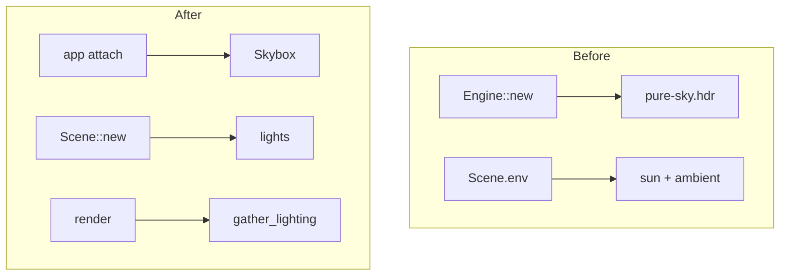
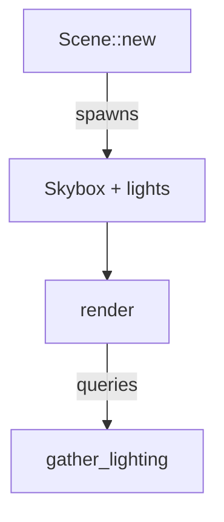

# Agent Instructions

## Communication

## Rules

- Never commit/push to main directly
- Never run destructive commands without approval
- Never commit secrets
- Ask before expanding scope

## Code Style

- Follow Pragmatic Programmer principles, communicate by referencing patterns in the book.
- Max 3 nesting levels
- Methods should be no longer than 50 lines
- Write self-documenting code to avoid verbose comments.
- Prefer small, focused functions
- Use intermediate variables for complex expressions
- Keep case statements under 3 lines and 1 level of nesting. Break logic into separate methods if needed.
- Avoid single letter variable names. Unless meaning is obvious and verbosity might hinder comprehension: short loop counters, comparators, and short closure parameters.

### Typescript Rules

- Don't await inside a condition/test expression — extract to an intermediate variable first. This applies to if / else if, while, and switch test expressions. Ternary (? :) expressions are excluded.
- Don't use `any` type.
- Don't use `| undefined` when declaring function arguments. Instead, use an optional argument or a default value.
- Don't use `return undefined` if a simple `return` will suffice.
- Indexed access is `T | undefined`. Narrow it before use — `const worker = workers[0]` must be followed by a guard, or wrapped in a helper that throws/returns a typed default. Never reach for `!` or `as` to silence it.
- Don't use non-null assertions (`!`) or type assertions (`as T`) to defeat the compiler. Use a type guard, an early return, or validation at the boundary.

## Diagrams

Mermaid diagrams render as ASCII in a terminal pane about 80 columns wide.
Anything wider wraps and breaks. Width is set by the widest row across the
whole diagram, so:

- Use `flowchart TD`, never `LR`.
- Max 2 nodes side by side in any row, counting every subgraph and chain.
- Each disconnected chain adds a column. Prefer one connected chain.
- No subgraphs side by side. For before/after, draw two separate diagrams.
- Node labels ≤ 16 characters. Edge labels ≤ 1 word, or none.
- Put detail in prose below the diagram, not in labels.
- Over ~8 nodes? Split into several small diagrams.

Bad (5 columns, two subgraphs side by side):

Good (one column, After only; Before gets its own diagram):

